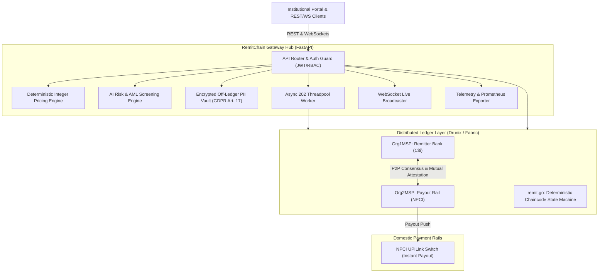
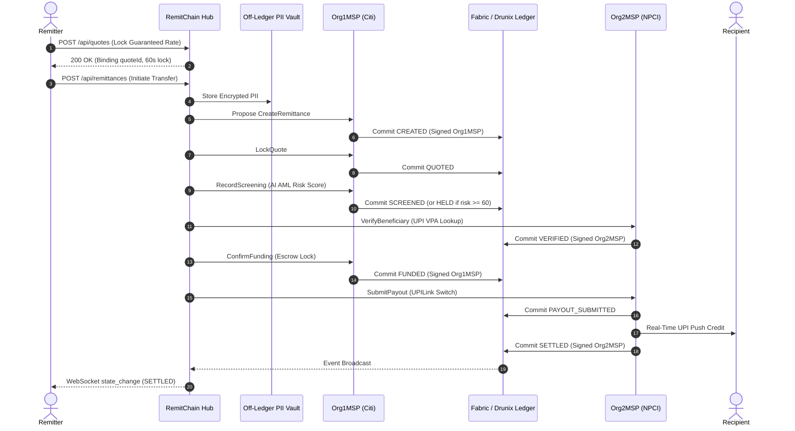

# RemitChain Architecture & Technical Specification

RemitChain is an institutional-grade, multi-org cross-border payment orchestration network connecting global remitting banks (e.g., Citi / Org1MSP) with domestic instant payout rails (e.g., NPCI UPI / Org2MSP) via a distributed ledger state machine and high-throughput API gateway.

---

## 1. High-Level System Architecture

---

## 2. Cryptographic Separation of Concerns

### The Zero-Plaintext Rule
To comply with global data privacy regulations (GDPR, India DPDP, CCPA), **plaintext Personally Identifiable Information (PII) is NEVER committed to the shared blockchain ledger**.

| Data Type | Storage Location | Encryption / Representation |
|-----------|------------------|-----------------------------|
| **Transaction State & Audit Trail** | On-Chain Ledger (`remit.go`) | Plaintext JSON state with salted SHA-256 hashes |
| **Sender & Beneficiary Identity** | On-Chain Ledger (`remit.go`) | Salted SHA-256 hashes (`senderHash`, `beneficiaryHash`) |
| **Plaintext PII (Names, VPAs, KYC)** | Off-Ledger Vault (`pii_vault.py`) | Authenticated symmetric keystream encryption at rest |
| **GDPR Right-to-be-Forgotten** | Off-Ledger Vault (`DELETE /api/pii/{rid}`) | Cryptographic key erasure & payload shredding |

When `DELETE /api/pii/{rid}` is executed, the off-ledger ciphertext is permanently purged. The immutable distributed ledger retains the cryptographic hashes and state proofs, ensuring regulatory auditability without retaining personal data.

---

## 3. End-to-End Remittance Sequence

---

## 4. Integer-Only Pricing Math & Parity

To prevent floating-point non-determinism across platforms, operating systems, and architectures, all financial calculations are performed strictly using 64-bit integer arithmetic in minor currency units (cents, pence, paise).

### Formula
$$\text{FeeFlatMinor} = \text{FlatFee}$$
$$\text{FeeVariableMinor} = \lfloor \frac{\text{SendMinor} \times \text{FeeBps}}{10000} \rfloor$$
$$\text{NetMinor} = \text{SendMinor} - (\text{FeeFlatMinor} + \text{FeeVariableMinor})$$
$$\text{EffectiveRateMicro} = \text{MidRateMicro} \times \frac{10000 - \text{SpreadBps}}{10000}$$
$$\text{ReceivePaise} = \lfloor \frac{\text{NetMinor} \times \text{EffectiveRateMicro}}{10^{\text{decimals} + 4}} \rfloor$$

### Decimal Normalization Table
| Currency | Decimals | Denominator ($10^{\text{decimals} + 4}$) | Minor Unit |
|----------|----------|-----------------------------------------|------------|
| **USD, EUR, GBP, AED, SGD, MYR** | 2 | $10^6 = 1,000,000$ | Cents / Pence |
| **JPY, KRW** | 0 | $10^4 = 10,000$ | Yen / Won |
| **BHD, KWD** | 3 | $10^7 = 10,000,000$ | Fils |

*Go (`chaincode/remit/pricing.go`) and Python (`hub/app/pricing.py`) implementations are locked together by shared test vectors in `testvectors/quote_vectors.json`.*

---

## 5. Cryptographic Audit Trail Verification

Every state transition produces an immutable audit record on the ledger containing:
- `step`: Transition name (e.g., `SCREEN`, `VERIFY_BENEFICIARY`, `SETTLE_PAYOUT`)
- `status`: New state machine status
- `org`: Endorsing organization MSP ID
- `txId`: Ledger transaction identifier
- `ts`: Unix epoch seconds
- `tsMs`: High-resolution microsecond-level timestamp

The hash-chain is verified via:
$$H_0 = \text{SHA-256}(\text{"REMITCHAIN\_GENESIS"})$$
$$H_i = \text{SHA-256}(H_{i-1} \parallel \text{step} \parallel \text{status} \parallel \text{org} \parallel \text{txId} \parallel \text{ts})$$

Calling `GET /api/remittances/{rid}/verify` recomputes this hash chain across the ledger trail and confirms that no timestamps, steps, or transaction records have been altered.

---

## 6. Observability & Telemetry

- **Sub-Second Telemetry**: `GET /api/latency` reports P50, P90, P95, and P99 latencies alongside individual step durations.
- **Prometheus Metrics**: `GET /metrics` provides counter and gauge metrics for transfer throughput, active WebSockets, volume, and latency distributions.
- **WebSocket Feed**: `ws://<host>/ws/events` streams state transitions live to dashboards.
